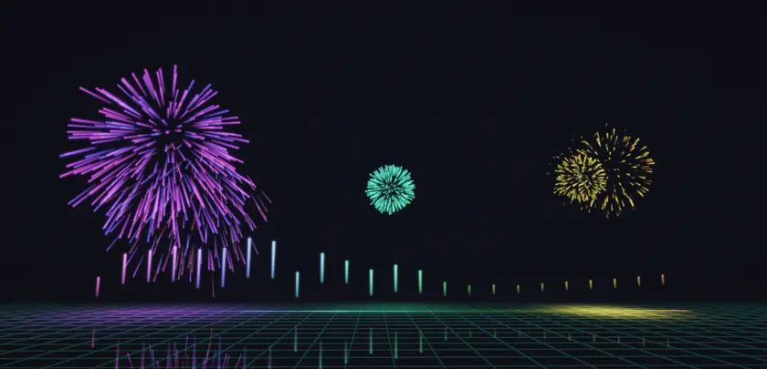
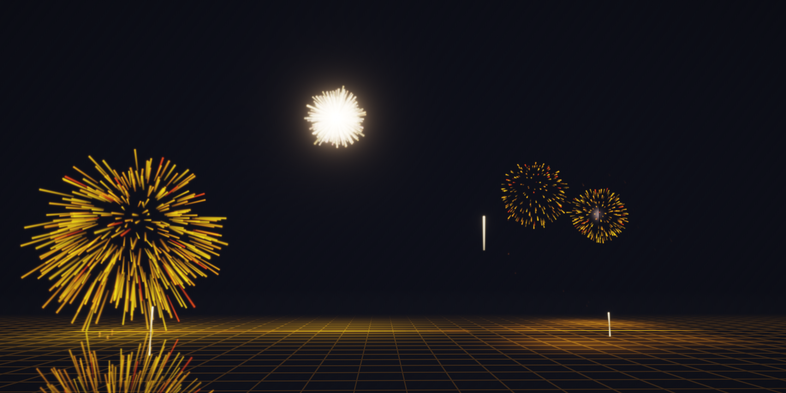
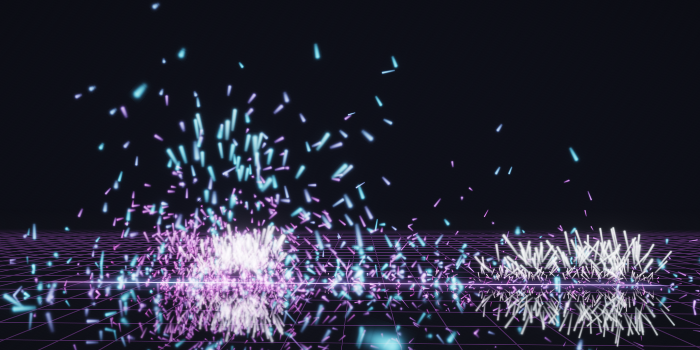
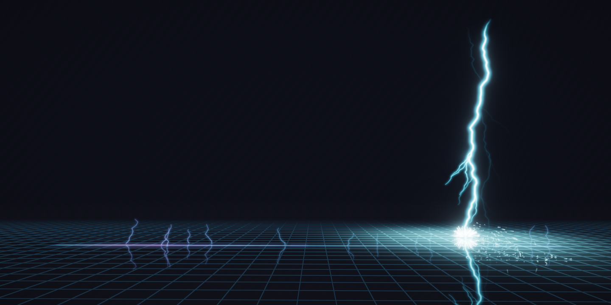
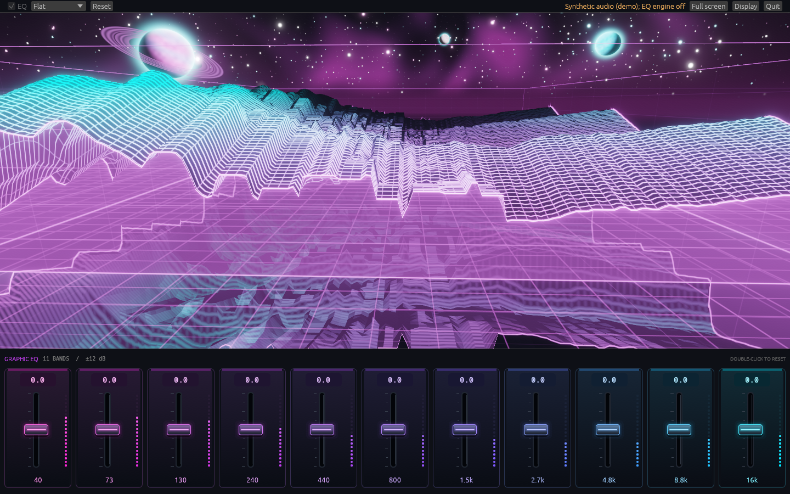

<h1 align="center"> SpectraForgeEQ</h1>
<p align="center">A system-wide PipeWire equalizer and live music visualizer for Linux Mint Cinnamon.</p>
<p align="center">
  <a href="#get-started"><strong>Install on Linux Mint</strong></a> &nbsp;·&nbsp;
  <a href="#visualization-gallery">Explore the eight scenes</a> &nbsp;·&nbsp;
  <a href="docs/development.md">Developer guide</a>
</p>

<picture>
  <source media="(prefers-reduced-motion: reduce)" srcset="docs/images/fireworks-prism.webp">
  
</picture>

**Fireworks · Prism Finale.** Follow the comets along the floor. A held note keeps its comet aloft. When the kick lands, a willow opens above the bass end of the line. Listen for the hi-hat and watch the small bursts on the right. [Download the eight-second demo with sound (MP4)](docs/media/fireworks-demo.mp4?raw=true)

## Get started

On **Linux Mint 22.3 with Cinnamon**, you'll need PipeWire, a Vulkan-capable GPU, Python 3 and a Rust toolchain with a C linker. The installer checks the desktop dependencies and installs the app for your user.

```sh
git clone https://github.com/nathan-standafer/graphic-eq.git
cd graphic-eq
cargo fetch --manifest-path gpu/Cargo.toml --locked
python3 packaging/install.py
```

Open **SpectraForgeEQ** from the application menu and play a track. Press **L** to pick a look, then **F** for full screen. Closing the window keeps the EQ running in the tray. Choose **Quit** from the tray to restore normal playback routing. [Requirements, startup options and removal](docs/installation.md)

## Visualization gallery

All eight scenes below are captures from the running app. The built-in demo supplies the same instruments to each one. Watch what a drum hit does to glass, water and light.

<table>
<tr>
<td width="50%" valign="top">
  
  <h3>Fireworks</h3>
  <p>24 comets trace the spectrum. Kicks open broad willows, snares bloom into round peonies, and hats throw short crackles.</p>
</td>
<td width="50%" valign="top">
  
  <h3>Ripple Pond</h3>
  <p>A kick punches a crater in the water. Falling droplets send smaller rings through the reflections of eleven light bars.</p>
</td>
</tr>
<tr>
<td width="50%" valign="top">
  
  <h3>Waterfall</h3>
  <p>The front edge is the spectrum right now. Each ridge behind it is an earlier instant, so a repeating rhythm leaves tracks across the glass.</p>
</td>
<td width="50%" valign="top">
  
  <h3>Aurora</h3>
  <p>A note lifts one part of the nearest curtain, then echoes through the sheets behind it. Bass stirs the lake below.</p>
</td>
</tr>
<tr>
<td width="50%" valign="top">
  
  <h3>Ferrofluid Orb</h3>
  <p>A rising pitch climbs a spiral of 192 spikes. Sustained bass swells the orb, and sharp attacks set its surface wobbling.</p>
</td>
<td width="50%" valign="top">
  
  <h3>Fountain</h3>
  <p>A sudden rise throws sparks from that frequency's spot on the floor. Steeper attacks send them higher before they bounce.</p>
</td>
</tr>
<tr>
<td width="50%" valign="top">
  
  <h3>3D Columns</h3>
  <p>Eleven meters give you a direct read on the mix. A kick throws sparks from the bass columns, and an accented hat lights the treble end.</p>
</td>
<td width="50%" valign="top">
  
  <h3>Lightning Storm</h3>
  <p>Low drums drive thick bolts into the glass. Higher hits split into thinner branches and leave a brief glow at the strike point.</p>
</td>
</tr>
</table>

[Scene-by-scene guide to sensitivity, particles, lighting and camera movement](docs/visualizations.md)

## Make it yours



**Set the sound.** The eleven faders span **40 Hz to 16 kHz**, each with **±12 dB** of gain in half-decibel steps. Start with one of ten EQ presets or dial in your own. PipeWire routes playback through the EQ while your volume keys keep controlling your speakers or headphones.

**Set the look.** Browse **30 looks** across the eight scenes, save favorites and cycle through them with crossfades. **Motion** controls movement and **Flash** controls transient lighting. For a slow flight around 3D Columns, Waterfall, Fountain or Fireworks, turn on **Display → Camera → Helicopter orbit**.

| Control | Action |
| --- | --- |
| Drag an EQ fader / double-click it | Adjust the gain / reset that band to 0 dB |
| EQ checkbox | Bypass or enable the equalizer |
| **L** / **1**–**9** | Browse looks / select a favorite or catalog look |
| **←** / **→** | Switch scenes |
| **F** or **F11** / **Esc** | Toggle full screen / leave full screen |
| Drag / scroll / middle-drag in the scene | Orbit / zoom / pan |
| Double-click the scene | Reset the camera |

## Under the hood

The analyzer listens before or after the EQ. An 8,192-sample FFT resolves the spectrum, while a 1,024-sample FFT tracks attacks every 10 ms. The drum detector distinguishes low drums, snares and hats or cymbals. Rust, egui and wgpu turn those signals into the window, particles, reflections and bloom. [Audio analysis and drum detection](docs/audio-analysis.md)

For build commands, tests and reproducible screenshots, see the [developer guide](docs/development.md). To suggest a scene or report a bug, see [Contributing](CONTRIBUTING.md) or [open an issue](https://github.com/nathan-standafer/graphic-eq/issues/new/choose).
