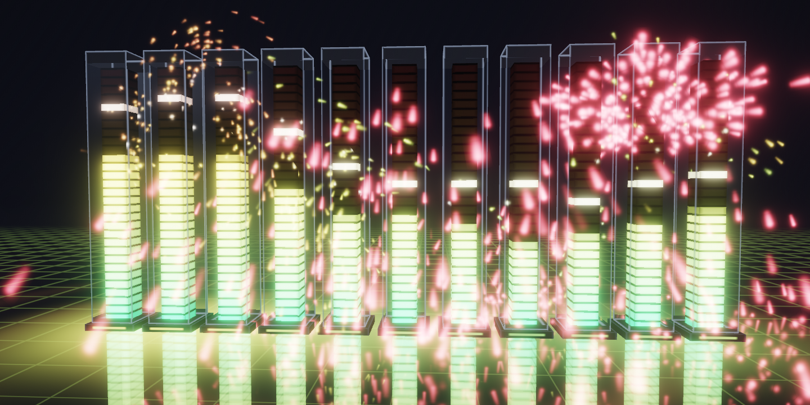
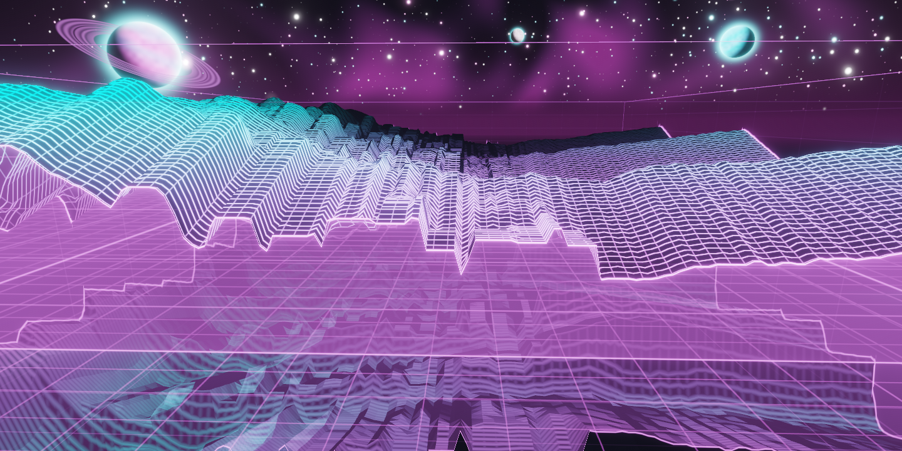
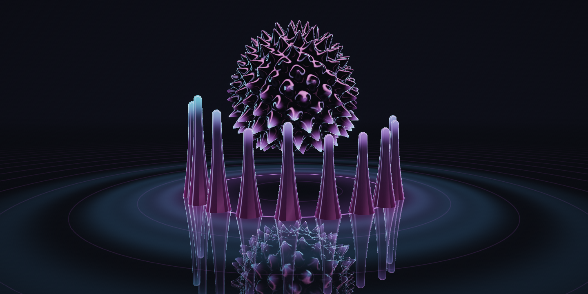
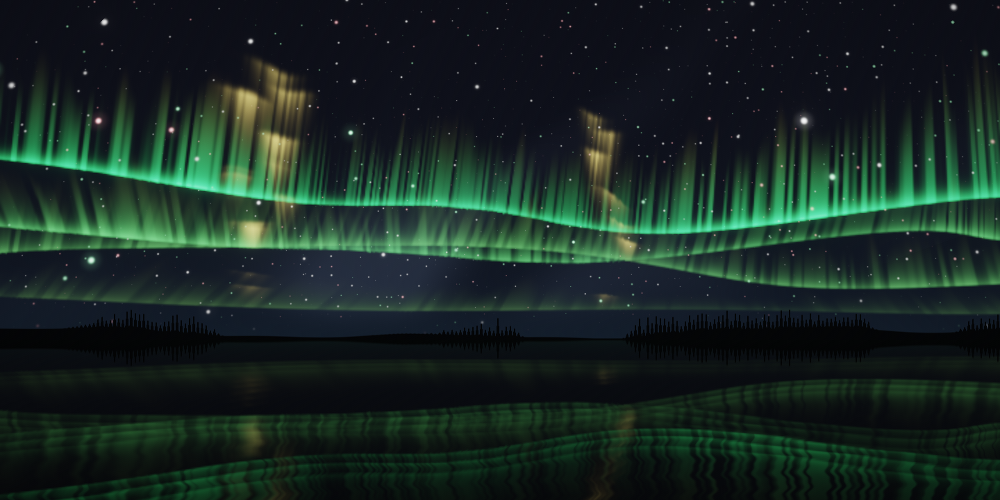
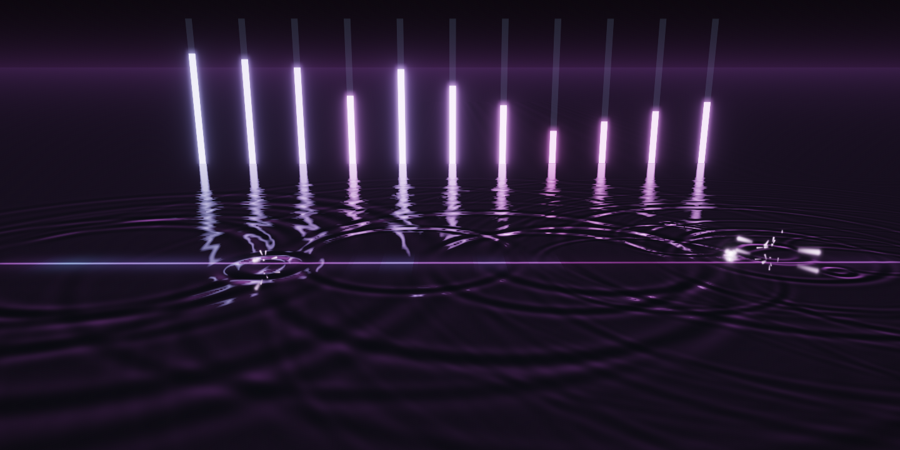

<div align="center">
  
  <h1>SpectraForgeEQ</h1>
  <p><strong>Shape your sound. See every frequency.</strong></p>
  <p>A system-wide equalizer and music-reactive visualizer for Linux Mint.</p>
  <p>
    
    
    
    
  </p>
  <p><a href="#visualization-gallery">Explore the scenes</a> · <a href="#get-started">Install</a> · <a href="#make-it-yours">Controls</a> · <a href="docs/development.md">Developer guide</a></p>
</div>


SpectraForgeEQ gives your desktop audio a set of illuminated hardware-style faders and a stage of its own. Tune eleven frequency bands, choose a visual look, and watch the music become glowing terrain, liquid metal, northern lights or ripples across a reflective pool.

Built with **Rust, egui and wgpu**, with **PipeWire** doing the actual equalization. The visuals follow the audio; the EQ keeps working when you close the window.

## Sound you control. A desktop app that stays out of the way.

- **Eleven bands, ±12 dB.** From 40 Hz to 16 kHz, with half-decibel steps, ten EQ presets, and a custom setting.
- **Faders that match your look.** Beveled illuminated handles, gain readouts and live signal meters follow the selected color scheme.
- **Eight music-reactive scenes.** Spectrum levels, onsets and detected drum hits drive different parts of each scene.
- **Your own visual mix.** Five color schemes, curated looks, favorites, crossfades, automatic cycling, and independent motion and flash controls.
- **Ready when you log in.** An application-menu launcher and tray icon, with saved settings restored on startup.
- **Quiet in the background.** Close the window to pause rendering and audio analysis while the equalizer continues. Quit explicitly to restore normal playback routing.

## Visualization gallery

Every image below is captured from the running app using its deterministic demo soundtrack. These are the actual renderers, with no mockups or post-processing.

<table>
<tr>
<td width="50%">
<h3>3D Columns</h3>

<p>Glass housings, glowing LED cores and sparks that answer the beat.</p>
</td>
<td width="50%">
<h3>Waterfall</h3>

<p>A living history of the spectrum, drawn as terrain beneath a night sky.</p>
</td>
</tr>
<tr>
<td width="50%">
<h3>Ferrofluid Orb</h3>

<p>Liquid metal, elastic lobes and 192 fine spikes, surrounded by eleven rising floor spikes.</p>
</td>
<td width="50%">
<h3>Aurora</h3>

<p>Translucent curtains of spectrum light fold above a reflective lake.</p>
</td>
</tr>
<tr>
<td width="50%">
<h3>Fountain</h3>

<p>Rising frequencies throw sparks into the air, then let them bounce and scatter.</p>
</td>
<td width="50%">
<h3>Fireworks</h3>

<p>Drum hits ignite willows, peonies and crackles, colored by the spectrum.</p>
</td>
</tr>
<tr>
<td width="50%">
<h3>Lightning Storm</h3>

<p>Branching strikes, return strokes and thunder rings follow the percussion.</p>
</td>
<td width="50%">
<h3>Ripple Pond</h3>

<p>Each hit disturbs the water beneath eleven frequency-driven light bars.</p>
</td>
</tr>
</table>

[Explore how the scenes work →](docs/visualizations.md)

## Get started

**Designed for Linux Mint with Cinnamon and PipeWire.** Desktop integration has been tested on Linux Mint 22.3/Cinnamon. You need a Vulkan-capable GPU and a Rust toolchain with a C linker to build the app.

```sh
git clone https://github.com/nathan-standafer/graphic-eq.git
cd graphic-eq

# Download the locked dependencies, then build and install for your user.
cargo fetch --manifest-path gpu/Cargo.toml --locked
python3 packaging/install.py
```

Open **SpectraForgeEQ** from your application menu. The installer adds the icon, launcher and login startup entry; it does not require `sudo`.

Runtime dependencies are PipeWire, `pipewire-pulse`, the PulseAudio utilities (`pactl` and `parec`), `pw-cli`, `pw-dump`, Python 3, PyGObject, GTK 3 and XApp. The installer checks these before installing. Rust is only needed to build, not to run the installed app.

> **Already running a development copy?** Quit it before opening the installed app. Subsequent launches reopen the existing SpectraForgeEQ window.

[Installation, startup options and uninstall →](docs/installation.md)

## Make it yours

| Control | Action |
|---|---|
| Drag an EQ fader | Adjust that frequency band |
| Double-click a fader | Reset it to 0 dB |
| EQ checkbox | Enable or bypass equalization |
| `F` / `F11` | Toggle full screen |
| `Esc` | Leave full screen |
| `←` / `→` | Change scene |
| `1`–`9` | Choose a visual preset from favorites or the catalog |
| `L` | Open the look browser |
| Drag / scroll / middle-drag | Orbit / zoom / pan |
| Double-click the scene | Reset the camera |

The **Display** menu holds colors, glow, scene settings, favorites and automatic cycling. **Motion** and **Flash** are separate controls, so you can keep the spectrum moving while dialing back the effects.

Click the **tray icon** to open the window. Right-click it for EQ enable/bypass, presets and Quit. Closing the window leaves the equalizer active; **Quit** stops it.

## Under the hood

```text
Desktop playback → PipeWire EQ → Your output device
                                      │
                               Audio analysis
                                      │
                          Rust + wgpu visualizations
```

The virtual EQ output processes playback streams while your normal output remains the system default. Volume keys continue controlling your real output device. Frequency analysis and drum detection feed the scene renderers; the GPU handles geometry, particles, reflections and bloom.

Settings are retained at `~/.config/graphic-eq/gpu-settings.json` for compatibility with earlier versions. The installed app is named **SpectraForgeEQ**; the source directory and development binary retain the `gpu` / `geq-gpu` names.

## Explore the project

| Guide | What you’ll find |
|---|---|
| [Installation](docs/installation.md) | Requirements, startup, CLI controls, upgrades and removal |
| [Visualizations](docs/visualizations.md) | Scene behavior and tuning controls |
| [Development](docs/development.md) | Build, tests, architecture and reproducible screenshots |
| [Audio analysis](docs/audio-analysis.md) | Spectrum analysis, drum detection and evaluation limits |
| [Contributing](CONTRIBUTING.md) | Useful bug reports and focused improvements |

Found a problem or have a scene idea? [Open an issue](https://github.com/nathan-standafer/graphic-eq/issues/new/choose).
